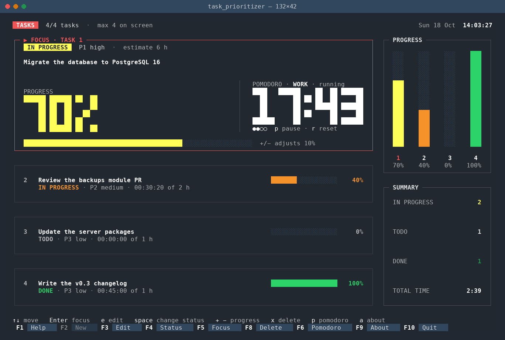

# task_prioritizer

[](https://github.com/xilen0x/task_prioritizer_tui/actions/workflows/ci.yml)
[](LICENSE)

A terminal task monitor written in Go with [Bubbletea](https://github.com/charmbracelet/bubbletea).
Up to four tasks on screen, one of them in focus, plus a pomodoro timer.
Laid out for a 132×42 terminal.
State saved by older versions under `~/.local/share/tareas/` is moved to the new data directory on first run.



## Requirements

**To run it**

- Linux or macOS with a terminal emulator that supports UTF-8 and 24-bit colour (true colour).
- A monospaced font that includes block and box-drawing characters (`█ ░ ▀ ▄ ╭ ─`).
  DejaVu Sans Mono, JetBrains Mono and most Nerd Fonts work.
- A terminal window of at least **100×30** characters. **132×42** or larger is recommended
  for the full layout with big digits.
- Optional: `notify-send` (package `libnotify-bin` on Debian/Ubuntu) for desktop notifications
  when a pomodoro phase ends. Without it, only the terminal bell rings.

**To build it**

- Go **1.23** or newer.

## Tested on

| | |
|---|---|
| OS | Ubuntu 22.04.5 LTS (x86_64) |
| Go | 1.23.6 |
| Terminals | GNOME Terminal, Terminator, Ghostty |

In GNOME Terminal, `F10` opens the terminal's own menu instead of quitting; use `q` there.

macOS and other Linux distributions are expected to work but have not been tested yet.
Windows has not been tested. Reports from other platforms are welcome.

## Install and run

```sh
go run ./cmd/task_prioritizer           # start (empty board on first run)
go run ./cmd/task_prioritizer --demo    # seed the sample tasks when no saved state exists

# or install the binary
go install github.com/xilen0x/task_prioritizer_tui/cmd/task_prioritizer@latest
```

| Flag | Default | Meaning |
|------|---------|---------|
| `--bar=blocks\|ascii\|thin` | `blocks` | Progress bar glyphs (the old `bloques`/`fino` values still work) |
| `--plain-digits` | `false` | Plain text instead of big block digits |
| `--demo` | `false` | Seed the four sample tasks if there is no saved state |
| `--no-alert` | `false` | Turn off the bell and desktop notification when a pomodoro phase ends |

Quit with `q`, `F10` or `Ctrl+C`. GNOME Terminal captures `F10` to open its menu by default;
use `q`, or turn off "Enable the menu accelerator key" in its preferences.

## Keys

| Key | Action |
|-----|--------|
| `↑` `↓` / `j` `k` | Move the selection |
| `Enter` / `F5` | Put the selected task in focus |
| `n` / `F2` | New task (at most 4) |
| `e` / `F3` | Edit the selected task |
| `Space` / `F4` | Cycle status: to do → in progress → done |
| `+` `=` / `-` | Progress ±10% |
| `x` / `Del` / `F8` | Delete (confirm with `y`/`Enter`, cancel with `n`/`Esc`) |
| `p` / `F6` | Pause or resume the pomodoro |
| `r` | Reset the pomodoro |
| `F1` / `?` | Help |
| `a` / `F9` | About |

In the editor: `Tab`/`Shift+Tab` or `↑`/`↓` change field, `←`/`→` change the value,
`Enter` saves and `Esc` cancels. The pomodoro and tracked time pause while the editor is open.
When a work block or a break ends, the app rings the terminal bell and, if `notify-send`
is installed, shows a desktop notification (e.g. "Pomodoro done — Take a 5 min break.").
Some terminals mute the bell or show it as a visual flash; check your terminal's settings.

Task time only accrues for the focused task, while it is *in progress* and the pomodoro is in a running work block.

Mouse support is best effort: click a row, the focus box or a sidebar column to select,
click a free slot to create a task, click the function-key bar, scroll to move the selection.

## Data

State is saved as JSON to `$XDG_DATA_HOME/task_prioritizer/state.json`
(default `~/.local/share/task_prioritizer/state.json`) after every change, every few seconds while the
pomodoro runs, and on quit. Writes are atomic (temp file + rename).
Status values are stored in English (`todo`, `doing`, `done`; pomodoro phases `work`, `break`).
Files written by the Spanish versions (`pendiente`, `curso`, `hecha`, `trabajo`, `descanso`)
are still read and mapped to the English values on load.

## Terminal size

The layout targets 132×42. Smaller terminals get a compact layout with plain digits;
below 100×30 a "terminal too small" notice is shown.

## Development

```sh
make check          # gofmt -l, go vet, go test
make update-golden  # regenerate TUI golden files
```

## Contributing

Issues and pull requests are welcome. See [CONTRIBUTING.md](CONTRIBUTING.md).

## Author

Carlos Astorga

## License

[MIT](LICENSE) © 2026 Carlos Astorga
